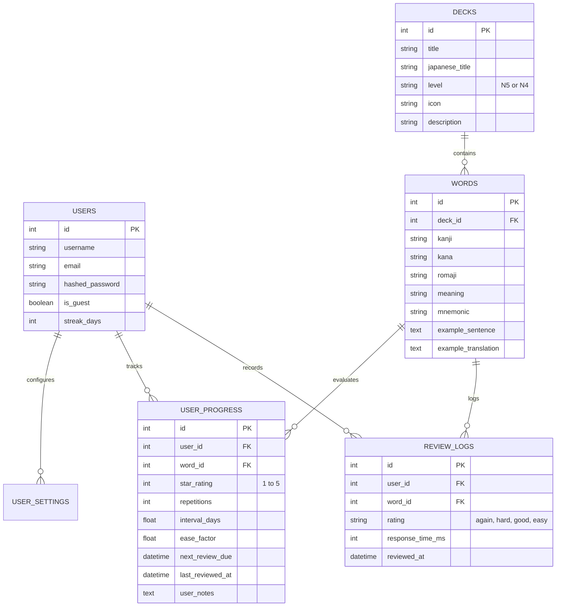

# 🌸 Kotoba Master (言葉マスター)
### *Next-Generation Japanese JLPT N5 / N4 Spaced-Repetition Platform*

[](https://fastapi.tiangolo.com/)
[](https://vitejs.dev/)
[](#-sm-2-scheduling-engine)
[](#-running-the-automated-test-suite)
[](Dockerfile)
[](#)

---

## 📌 Overview

**Kotoba Master (言葉マスター)** is a Japanese vocabulary learning platform designed for learners tackling **JLPT N5 and N4**. Inspired by AHA Lab's kanji flashcard design, it replaces simple linear quizzes with a **SuperMemo SM-2 Spaced Repetition (SRS) due-date scheduling engine**, an intuitive **1–5 Star visual mastery tier**, and a bespoke Japanese historical design language.

```
       Landing (Oda Nobunaga Red & Cream, Live 3D Flip Card)
                               │
            ┌──────────────────┴──────────────────┐
            ▼                                     ▼
   Instant Guest Mode                    User Registration & Login
 (0-click trial session)                 (JWT + Password Recovery)
            └──────────────────┬──────────────────┘
                               ▼
        Onboarding (Fumayo Notebook Grid Paper & Mascot)
         [ Level Select -> Daily Target -> First Deck ]
                               ▼
            Dashboard (Due Queue, Streak, 5★ Breakdown)
                               ▼
     Calm Review Session (3D Card Flip, 4 SM-2 Ratings, Audio)
                               ▼
       Session Summary (Oda Nobunaga Victory Banner + Confetti)
```

---

## ✨ Key Features

### 🧠 1. Due-Date Spaced Repetition (SuperMemo SM-2)
- Replaces weighted random quizzes with calculated **due-date intervals**.
- Four performance ratings per card:
  - **Again (1)**: Reset interval to 1 day, penalty on ease factor (-0.20).
  - **Hard (2)**: 1.2× interval multiplier, slight ease reduction (-0.15).
  - **Good (3)**: Optimal SM-2 interval progression (1d $\rightarrow$ 6d $\rightarrow$ $I \times EF$).
  - **Easy (4)**: Accelerated interval ($1.3 \times$ bonus, +0.15 ease factor).
- **Periodic Mastered Reinforcement**: Mastered 4★ and 5★ words occasionally interleave into current review decks to guarantee lifetime retention without recall fade.

### ⭐ 2. 5-Star Visual Mastery System
- Transparent proficiency tiers mapped to calculated memory intervals:
  - **1★ (New / Learning)**: Repetition interval $< 1$ day
  - **2★ (Early Recall)**: Repetition interval 1–4 days
  - **3★ (Solidifying)**: Repetition interval 5–14 days
  - **4★ (Strong Retention)**: Repetition interval 15–30 days
  - **5★ (Mastered)**: Repetition interval $> 30$ days

### 🎌 3. Oda Nobunaga & Japanese Design System
- **Landing & Victory Summary**: Bold Oda Nobunaga aesthetic with crimson red (`#D8003A`), aged cream (`#F3EBDD`), giant condensed display typography (*Anton* / *Dela Gothic One*), thin framed panels, and vertical kanji callouts.
- **Deck Library**: Opaque-style pastel cards with custom illustrated theme icons.
- **Onboarding & Empty States**: Fumayo-style notebook grid paper, mascot guidance, and sticker badges.
- **Calm Review Screen**: Clean, distraction-free card review featuring huge Japanese kanji (*Noto Serif JP*), star-coded color bands, paper textures, smooth 3D CSS flip animations, and bottom-anchored controls for one-handed mobile review.

### 🎧 4. Integrated Audio & AI Mnemonics
- **Native Pronunciation**: Integrated Japanese Text-to-Speech via Web Speech API (`ja-JP`).
- **Gemini AI Mnemonics & Sentences**: On-demand and pre-cached contextual example sentences and mnemonic breakdowns via Google Gemini 1.5, with server-side caching and rate limiting.

### 📊 5. Comprehensive Analytics & Data Portability
- **365-Day Activity Heatmap**: Visual log of daily review volume.
- **30-Day Accuracy Trend**: Tracks proportion of successful recall without resets.
- **14-Day Due Forecast**: Previews upcoming review load scheduled by SM-2.
- **JSON Data Portability**: 1-click full JSON export and restore of study history.

---

## 🗄️ Database Architecture

Supports **SQLite with WAL mode** for fast zero-config local development, and **PostgreSQL** with connection pooling (`pool_pre_ping=True`, `pool_size=10`) for production environments.



---

## 🚀 Quickstart Guide

### 1. Local Development (Backend + Frontend)

#### Prerequisites
- Python 3.11+
- Node.js 18+ and npm

#### Backend Setup
```bash
# Clone the repository
git clone https://github.com/KiskuAryan/kotoba-master.git
cd kotoba-master

# Create and activate virtual environment
python3 -m venv backend/venv
source backend/venv/bin/activate

# Install dependencies
pip install -r backend/requirements.txt

# Start backend server (auto-seeds 14 themed decks)
PYTHONPATH=backend uvicorn app.main:app --reload --port 8000
```

#### Frontend Setup (Vite + React)
```bash
# In a separate terminal:
cd frontend
npm install
npm run dev
```
Open **[http://localhost:5173](http://localhost:5173)** (or **[http://localhost:8000](http://localhost:8000)** when building for production).

---

### 2. Building for Production

```bash
# Build React frontend
cd frontend
npm run build
cd ..

# FastAPI automatically serves frontend/dist at root /
PYTHONPATH=backend uvicorn app.main:app --host 0.0.0.0 --port 8000
```

---

### 3. Docker Deployment

```bash
# Build and run the self-contained multi-stage container
docker build -t kotoba-master .
docker run -p 8000:8000 -e JWT_SECRET=your_secret_key kotoba-master
```

---

### 4. Deploying to Render with PostgreSQL

The project includes an infrastructure-as-code blueprint in [`render.yaml`](render.yaml):

1. Push your repository to GitHub.
2. In the [Render Dashboard](https://dashboard.render.com), select **New > Blueprint**.
3. Connect your `kotoba-master` repository.
4. Render automatically provisions:
   - **PostgreSQL Database** (`kotoba-postgres`, free tier)
   - **Web Service** with Python 3.11 & Node 20 runtime
   - Automated environment variable wiring (`DATABASE_URL`, `JWT_SECRET`)
5. Optional: Add `GEMINI_API_KEY` in Render environment settings for live sentence generation.

---

## 🧪 Automated Pytest Suite

Kotoba Master includes comprehensive unit and integration tests covering scheduling mathematics, JWT authentication, guest mode, deck progression, and API routing.

```bash
PYTHONPATH=backend pytest backend/tests/ -v
```

```
backend/tests/test_algorithm.py .....                                    [ 15%]
backend/tests/test_api.py ........                                       [ 39%]
backend/tests/test_auth.py .....                                         [ 54%]
backend/tests/test_database.py ...                                       [ 63%]
backend/tests/test_new_api_endpoints.py ......                           [ 81%]
backend/tests/test_sm2_scheduling.py ......                              [100%]

======================== 33 passed in 5.09s =========================
```

---

## ⌨️ Keyboard Shortcuts (Review Screen)

| Key | Action |
| :---: | :--- |
| `Space` | Flip card to reveal readings, meaning, sentence & mnemonic |
| `1` | Rate card as **Again** (< 1 day) |
| `2` | Rate card as **Hard** |
| `3` | Rate card as **Good** (optimal SM-2 progression) |
| `4` | Rate card as **Easy** (bonus interval multiplier) |

---

## 📄 License
MIT License. Created for Japanese language students worldwide.
