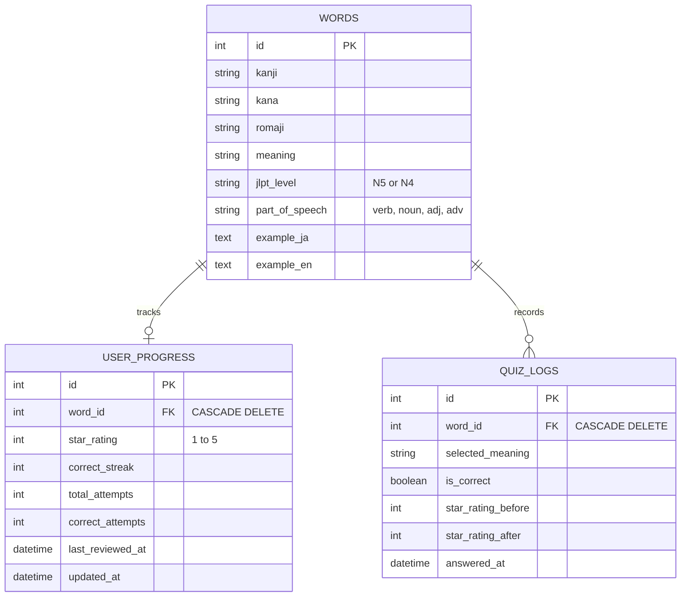

# 🌸 KotobaMaster (言葉マスター)
### *5-Star Spaced Recall Mastery & Vocabulary SRS Engine for JLPT N5 / N4*

[](https://www.python.org/)
[](https://fastapi.tiangolo.com/)
[](https://www.sqlite.org/)
[](Dockerfile)
[](#)
[](#)

---

## 📌 Problem & Motivation

Preparing for the **Japanese Language Proficiency Test (JLPT N5 and N4)** requires memorizing hundreds of essential kanji, readings, and vocabulary words. Traditional flashcards suffer from two issues:
1. **Linear repetition fatigue**: Reviewing words you already know wastes valuable study time.
2. **Binary right/wrong recall**: Standard flashcards do not model confidence or long-term retention decay.

**KotobaMaster** solves this by implementing a **5-Star Spaced Repetition System (SRS)** driven by an **inverse-weighted probability sampling algorithm**:
* Difficult or new words (⭐ 1 Star) appear frequently in recall quizzes.
* As you demonstrate consecutive correct recalls, words graduate to higher star ratings (up to ⭐⭐⭐⭐⭐ 5 Stars).
* Mastered words appear at an exponentially lower frequency, maximizing memory consolidation efficiency.

---

## 🏗️ System Architecture

```
                                  [ User Browser ]
                                         │
                   ┌─────────────────────┴─────────────────────┐
                   │                                           │
         [ 🎯 5-Star Recall Quiz ]                  [ 📚 Deck & Analytics ]
         • Keyboard Shortcuts (1-4)                 • Search & Star Filters
         • Web Speech API (ja-JP TTS)               • Real-Time Mastery Chart
                   │                                           │
                   └─────────────────────┬─────────────────────┘
                                         │ HTTP REST JSON
                                         ▼
                             ┌───────────────────────┐
                             │    FastAPI Backend    │
                             └───────────┬───────────┘
                                         │
        ┌────────────────────────────────┼────────────────────────────────┐
        ▼                                ▼                                ▼
┌───────────────────────┐    ┌───────────────────────┐    ┌───────────────────────┐
│ 5-Star SRS Algorithm  │    │  SQLAlchemy Relational│    │ ✨ AI Context Engine  │
│ • Inverse Probability │    │  • Word Models        │    │ • Gemini 1.5 Flash    │
│ • Dynamic Distractors │    │  • User Progress      │    │ • Furigana & Grammar  │
│ • Streak Penalties    │    │  • SQLite (WAL Mode)  │    │ • Mnemonic Breakdown  │
└───────────────────────┘    └───────────────────────┘    └───────────────────────┘
```

---

## 📐 Mathematical Model: 5-Star Spaced Recall Engine

### 1. Inverse-Weighted Sampling
When fetching the next quiz question, each word's appearance probability $P(w)$ is weighted inversely to its mastery level:

$$\text{Weight}(s) = \begin{cases} 
10.0 & \text{if } s = 1\star \text{ (Unfamiliar / High Priority)} \\
6.0 & \text{if } s = 2\star \text{ (Learning)} \\
3.0 & \text{if } s = 3\star \text{ (Familiar)} \\
1.0 & \text{if } s = 4\star \text{ (Strong)} \\
0.2 & \text{if } s = 5\star \text{ (Mastered / Rare Retention Check)}
\end{cases}$$

### 2. Graduation & Penalty Transitions
* **Correct Recall**: Increments the word's streak. When the threshold is met, the word graduates:
  * $1\star \rightarrow 2\star$: Requires 1 correct recall
  * $2\star \rightarrow 3\star$: Requires 2 consecutive recalls
  * $3\star \rightarrow 4\star$: Requires 4 consecutive recalls
  * $4\star \rightarrow 5\star$: Requires 6 consecutive recalls
* **Incorrect Recall**: Resets streak to 0 and incurs an immediate demotion penalty:
  * $5\star \rightarrow 3\star$ ($-2$ penalty; requires quick re-review)
  * $4\star \rightarrow 2\star$ ($-2$ penalty)
  * $3\star, 2\star \rightarrow 1\star$ ($-1$ penalty)

---

## 🗄️ Relational Database Schema



---

## 🚀 Quickstart & Setup

### Option 1: Local Development (Python 3.11+)

```bash
# 1. Clone repository & enter project directory
cd kotoba-master

# 2. Create and activate virtual environment
python3 -m venv backend/venv
source backend/venv/bin/activate

# 3. Install dependencies
pip install -r backend/requirements.txt

# 4. Start FastAPI server (tables & 50 JLPT seed words auto-initialize)
PYTHONPATH=backend uvicorn app.main:app --reload --port 8000
```
Open **[http://localhost:8000](http://localhost:8000)** in your browser.

---

### Option 2: Docker & Docker Compose

```bash
# Build and run containerized service
docker-compose up --build
```
Access the application at **[http://localhost:8000](http://localhost:8000)**.

---

## 🧪 Running the Automated Test Suite

```bash
PYTHONPATH=backend pytest backend/tests/ -v
```

**Test Coverage Highlights:**
* `test_database.py`: Model relationships, SQLite WAL pragmas, check constraints, cascade deletes, and idempotent seeding.
* `test_algorithm.py`: Probability weight distributions, streak graduation, and mistake penalty logic.
* `test_api.py`: FastAPI endpoints, static frontend delivery, quiz submission flow, and deck analytics.

---

## 🎯 Global Innovation Consulting (GIC) Skill Alignment

| GIC Skill Tag | How KotobaMaster Demonstrates It |
| :--- | :--- |
| **Database Design** | Relational schema in SQLite/PostgreSQL with foreign key cascade actions, check constraints, and indexed lookups. |
| **Application Development** | Full-stack FastAPI web app with asynchronous endpoints, Pydantic schemas, and interactive single-page UI. |
| **Algorithm & Logic** | Non-trivial mathematical modeling of memory retention via inverse-weighted random distributions. |
| **AI Integration** | Google Gemini 1.5 Flash endpoint generating natural conversational Japanese examples and mnemonics. |
| **Cloud & DevOps** | Multi-stage Docker image, Docker Compose service, and GitHub Actions CI workflow. |
| **Japanese Language (JLPT)** | Authentic focus on Japanese N5/N4 vocabulary, Japanese pitch audio (TTS), and business communication readiness. |
